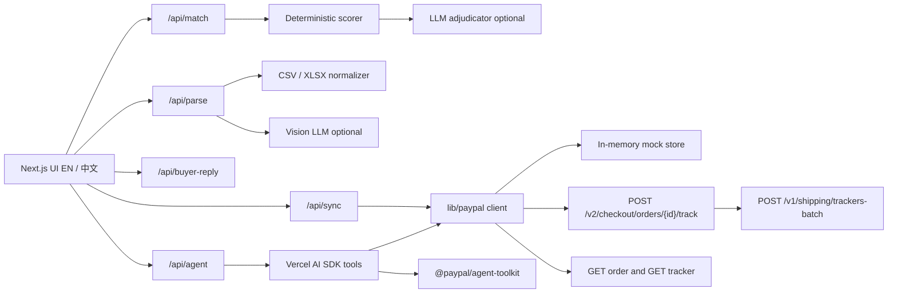

# ShipBridge

ShipBridge is a tracking desk for Chinese cross-border sellers who get paid on PayPal. After a batch ships with YunExpress (云途), 4PX, or Yanwen (燕文), the seller drops in the carrier spreadsheet — or a screenshot, when an LLM key is set — and ShipBridge matches each row to a PayPal order, flags addresses that would break Seller Protection, and writes the tracking numbers back in bulk.

The UI is English, with an EN / 中文 toggle. Buyer emails stay in English on the way out. The explanation of those emails is in Chinese, so the seller can see mood, ask, and dispute risk before copying a reply.

Sample manifests and the ten demo orders are fake. Filenames and this README say **SAMPLE**. Do not ship real customer data into the mock store.

## The problem

New PayPal sellers often wait up to 21 days for funds. Adding a tracking number, then waiting for the carrier to confirm delivery, is how PayPal releases many of those holds about a day after delivery.

- A first-time seller sees the balance on hold: [r/paypal, “I recieved money but it's on hold?”](https://www.reddit.com/r/paypal/comments/1gsryw8/i_recieved_money_but_its_on_hold/) and [“FIRST TIME USING PAYPAL MONEY ON HOLD!!”](https://www.reddit.com/r/paypal/comments/1maqgad/first_time_using_paypal_money_on_hold/).
- Sellers tell each other that putting the tracking number into PayPal helps: [r/Ebay](https://www.reddit.com/r/Ebay/comments/fabj3y/paypal_hold_for_21_days/) and [r/discogs](https://www.reddit.com/r/discogs/comments/1kpfdpn/payment_held_for_21_days_wait_to_ship/).
- A public post walks day 1 to day 21: [X @TavarovWallet](https://x.com/TavarovWallet/status/2115507464015954005).
- PayPal’s own help says funds can release about 24 hours after the carrier confirms delivery once tracking is added: [How can I release my payments on hold?](https://www.paypal.com/us/cshelp/article/how-can-i-release-my-payments-on-hold-help129).
- Chinese sellers describe the same 21-day review: [知乎](https://www.zhihu.com/question/401854201/answer/2603501326) and [SHOPYY](https://www.shopyy.com/article/7975.html).

Passing tracking into PayPal is still a one-order-at-a-time chore unless the shop is on Shopify and the seller pays for a sync app.

- [r/shopify, “Automate Sending tracking details to PayPal”](https://www.reddit.com/r/shopify/comments/1h391q0/automate_sending_tracking_details_to_paypal/) (paid tools such as Track123 come up in the thread).
- [Shopify Community](https://community.shopify.com/t/why-isnt-my-paypal-tracking-being-automatically-applied/314119).
- Paid products that only cover Shopify: [TrackiPal](https://apps.shopify.com/trackipal), [Synctrack](https://synctrack.io/paypal-tracking/).
- The manual checklist (photo of the label, ship only to the PayPal address, add the number): [X @GGDLCSHOP](https://x.com/GGDLCSHOP/status/2113243144456221101).

“Item not received” cases are lost when the tracking or the ship-to address does not meet Seller Protection, even when the seller has a scan.

- [r/paypal, “PayPal sided with the buyer despite clear proof”](https://www.reddit.com/r/paypal/comments/1k705qu/paypal_sided_with_the_buyer_despite_clear_proof/).
- [r/paypal, buyer INR claim, seller out $2.5k](https://www.reddit.com/r/paypal/comments/ytb2pw/paypal_buyer_opened_claim_of_item_not_delivered_i/).
- [r/Depop, lost a case with a tracking number](https://www.reddit.com/r/Depop/comments/p86u49/lost_paypal_case_even_though_i_had_tracking/).
- [X @thebigwheel641](https://x.com/thebigwheel641/status/2102466385733439744).

Chinese cross-border merchants hit the same freeze and INR pattern at a much larger scale, and almost no English tooling is built for their carrier exports.

- [21世纪经济报道 on frozen cross-border accounts](http://www.21jingji.com/article/20220720/herald/87fbd443208a74170397adc3821d0b7b.html).
- [AMZ123 on the 21-day review for new accounts](https://m.amz123.com/t/PBsDUqVE).
- [易仓: answer “item not received” with tracking](https://weplus2.eservicesgroup.com.cn/news/78115).
- [Airwallex 2026 guide to frozen independent-site accounts](https://www.airwallex.com/cn/blog/independent-site-payment-account-frozen-guide).

## How this helps PayPal

China is one of PayPal’s largest cross-border merchant bases. Those sellers often ship with YunExpress, 4PX, and Yanwen, then copy tracking numbers by hand. When the number never lands on the PayPal order:

- Item-not-received disputes and claims go up, because the buyer and PayPal cannot see a scan.
- Funds sit in the 21-day hold instead of releasing after delivery.
- Support load grows on both the merchant and PayPal side.
- Sellers who cannot get the money out switch processors.

ShipBridge is the batch path those sellers actually have: a carrier file in, matched orders out, tracking written with `notify_payer: false`, then read back so the seller can see the number is really on the order. Address mismatches are called out before the parcel leaves, which is the Seller Protection rule “ship only to the PayPal address.”

Shopify sync apps do not cover independent sites, social checkout, or invoice sellers. Single-parcel photo tools do not cover a morning’s export from a Chinese warehouse.

## Features

- Upload CSV or XLSX. YunExpress, 4PX, and Yanwen headers are recognized, including 运单号 / 收件人 / 邮编 / 国家 / 品名. Rows normalize to tracking number, carrier, recipient, postcode, country, city, item, quantity, and reference.
- Screenshot upload calls an OpenAI-compatible vision chat with an `image_url` data URL. With no LLM key the API returns a clear message and points at the samples.
- Deterministic matcher: name similarity (case, diacritics, token order), postcode exact or prefix, country, item keyword overlap, invoice / reference exact match. Score is 0–100 with reasons. Optional LLM adjudication for scores 40–80, ignored if the call fails.
- AG Grid Community grid: tracking, carrier, recipient, PayPal order, buyer, confidence badge, address check, sync status, and an override dropdown. Checkbox selection. Postcode or country mismatches are red and show “Seller Protection risk: ship only to PayPal address.”
- **Sync tracking to PayPal** writes selected rows, or, if nothing is selected, confident non-red rows. Red rows sync only when the seller checks them. Primary call is Orders v2 `POST /v2/checkout/orders/{id}/track`. Fallback is `POST /v1/shipping/trackers-batch`. A row turns green “verified in PayPal” only after a read-back contains the tracking number.
- Dashboard: order count, simulated payments on hold, amount on hold, tracking synced, and estimated days released earlier versus a 21-day hold (ship date + transit days by carrier and country + 1). A **Simulated** badge states that the PayPal sandbox has no real holds.
- Buyer panel: paste an English “where is my order” email, auto-detect the order, get a Chinese brief and an English reply with carrier, tracking number, and a **simulated** timeline. Copy button. Template fallback when no LLM key is set.
- Agent mode route `POST /api/agent`. With an LLM key, the Vercel AI SDK (`ai` + `@ai-sdk/openai-compatible`) receives tools named `get_order`, `create_shipment_tracking`, and `get_shipment_tracking`. In sandbox or live mode those names are filled by `@paypal/agent-toolkit` (`PayPalAgentToolkit` from `@paypal/agent-toolkit/ai-sdk`) when the package loads, and ShipBridge’s direct client remains as a fallback. With no key, the same tools run deterministically so the demo still finishes.
- `PAYPAL_MODE=mock` (also the default when `PAYPAL_CLIENT_ID` is empty) serves ten captured SAMPLE orders. The track call writes the in-memory store and read-back works.

## Architecture



Carrier codes live in one module, `lib/carriers.ts`, with comments pointing at PayPal’s carrier reference. Confirmed enums used here: `YUNEXPRESS`, `FOUR_PX_EXPRESS`, `YANWEN`, `CN_CHINA_POST_EMS` (China Post / EMS), `DHL`, `UPS`, `FEDEX`, `USPS`. Anything else is `OTHER` plus `carrier_name_other`.

## PayPal APIs

| Use | API |
| --- | --- |
| OAuth | `POST /v1/oauth2/token` with `client_credentials` (cached) |
| Create demo orders | `POST /v2/checkout/orders` intent `CAPTURE` |
| Capture after buyer approval | `POST /v2/checkout/orders/{id}/capture` |
| Add tracking | `POST /v2/checkout/orders/{id}/track` with `capture_id`, `tracking_number`, `carrier`, optional `carrier_name_other`, `notify_payer: false` |
| Fallback batch | `POST /v1/shipping/trackers-batch` |
| Read back | `GET /v2/checkout/orders/{id}` and `GET /v1/shipping/trackers/{captureId}-{trackingNumber}` |
| Agent tools | `@paypal/agent-toolkit` shipment `create` / `show` and orders `get` |

Base URL follows `PAYPAL_ENV` (`sandbox` default, or `live`) or `PAYPAL_BASE_URL`. Sandbox host is `https://api-m.sandbox.paypal.com`.

The toolkit’s `create_shipment_tracking` talks to the v1 trackers API. The Sync button prefers Orders v2 and falls back to v1. If the toolkit fails to construct, Agent mode keeps the direct REST tools. Mock mode does not call the toolkit, because the toolkit needs real credentials and cannot see the in-memory store.

## Setup

Node 20+.

```bash
cd shipbridge
npm install
cp .env.example .env
npm run build
PAYPAL_MODE=mock npm run start
```

Open http://localhost:3000. The app runs with an empty `.env`. Mock mode is selected when `PAYPAL_MODE=mock` or when `PAYPAL_CLIENT_ID` is missing.

### Mock demo

1. The header chips should read `PayPal: mock` and `AI: off (rules)`.
2. Click **Use sample**. That loads all three SAMPLE files (10 rows).
3. Click **Match PayPal orders**. Emily Carter and the other exact rows match. Micheal Obrien matches Michael O'Brien. Chloe Davis matches Chloe Davies. Anna Schmidt is red because the manifest postcode is 10117 and PayPal has 10115. Noah Bennett has no order.
4. Click **Sync tracking to PayPal**. Confident rows turn green after read-back. Anna stays skipped until her checkbox is selected and you sync again.
5. Paste a “where is my order” email that mentions SB-1001, or click **Sample email**, then **Draft reply**.

`POST /api/seed` resets the mock store. **Reset demo** does the same.

### Sandbox

```bash
PAYPAL_MODE=sandbox
PAYPAL_ENV=sandbox
PAYPAL_CLIENT_ID=your_sandbox_client_id
PAYPAL_CLIENT_SECRET=your_sandbox_secret
```

```bash
npx tsx scripts/seed-sandbox.ts
```

The script creates one `CAPTURE` order per SAMPLE buyer and prints an approve link. Log in as the sandbox **personal** buyer and approve each order. Then:

```bash
npx tsx scripts/capture.ts <orderId> <orderId> ...
```

Created ids are stored in `data/sandbox-orders.json` (gitignored). `GET /api/orders` loads those ids. `POST /api/seed` in sandbox mode creates the same set again. Captured orders can then be matched and synced through Orders v2.

In mock mode the seed script only prints the in-memory catalog and does not call PayPal.

### Environment

| Variable | Purpose |
| --- | --- |
| `PAYPAL_MODE` | `mock` (default without a client id), `sandbox`, or `live` |
| `PAYPAL_ENV` | `sandbox` (default) or `live`. Chooses the API host when not mocking |
| `PAYPAL_BASE_URL` | Optional full override |
| `PAYPAL_CLIENT_ID` / `PAYPAL_CLIENT_SECRET` | REST app credentials. Never commit them |
| `LLM_BASE_URL` | OpenAI-compatible base, usually ending in `/v1` |
| `LLM_API_KEY` | Bearer token |
| `LLM_MODEL` | Chat model id. Required together with the two fields above |
| `LLM_VISION_MODEL` | Optional. Defaults to `LLM_MODEL` |

`GET /api/health` returns `{ ok, paypal, ai, model, visionModel }`.

### Checks

```bash
npm test
PAYPAL_MODE=mock npm run start
node scripts/verify.mjs
node scripts/screenshot.mjs
```

`scripts/verify.mjs` expects the app on port 3000 and prints `PASS` / `FAIL` lines. Screenshots land in `screenshots/`.

Regenerate the 4PX workbook with `npm run samples` after editing `scripts/generate-samples.mjs`.

## Simulated holds

PayPal’s sandbox does not place real 21-day holds. The on-hold count, the amount, and “days released earlier” are computed in `lib/holds.ts`:

- Natural release = payment date + 21 days.
- Early release = ship date + transit days for that carrier and country + 1 day.
- Days earlier = the gap between those two dates.
- An order stays “on hold” in the demo until that release date. Today’s date in the seed data is around 11 Nov 2026, so the orders are still inside both windows. Syncing tracking moves the estimated release earlier. It does not move real money.

The timeline in the buyer reply is the same kind of estimate. It is labeled simulated. It is not a carrier scan.

## Demo script (about 2.5 minutes)

1. **0:00** A Chinese one-person shop has PayPal orders and the money looks frozen for 21 days. Say that China is a large PayPal cross-border merchant base, and that Shopify-only sync apps do not cover this seller.
2. **0:25** Open ShipBridge. Point at `PayPal: mock`, `AI: off (rules)`, and the Simulated badge. The sandbox cannot freeze funds, so the hold numbers are an estimate.
3. **0:40** Click **Use sample**. Mention the files are fake SAMPLE exports from YunExpress, 4PX, and Yanwen, including Chinese headers.
4. **1:05** Click **Match PayPal orders**. Show a high-confidence exact match, the Micheal / Michael typo, and the red Anna Schmidt row: postcode 10117 versus PayPal 10115. Read the Seller Protection line: ship only to the PayPal address. Noah Bennett has no order.
5. **1:30** Click **Sync tracking to PayPal**. Red rows are skipped. Green rows say verified in PayPal because the app read the tracking number back. Optionally check Anna and sync her on purpose.
6. **1:55** Paste “Where is my order??” for Emily Carter / SB-1001. Show the Chinese brief (mood, ask, dispute risk) and the English reply with carrier, tracking number, and the labeled demo timeline. Hit copy.
7. **2:20** Close on the PayPal outcome: fewer item-not-received disputes, faster release after delivery, less support, and a reason for cross-border merchants to stay.
8. **2:35** Stop. Keep the video under three minutes.

## Limitations and roadmap

- Holds and transit times are simulated. Sandbox webhooks will not fire a real release.
- The mock store lives in process memory (`globalThis`). A Vercel cold start resets it. Sandbox orders live at PayPal; their ids are listed in `data/sandbox-orders.json` on the machine that ran the seed script.
- The buyer timeline is not fetched from YunExpress, 4PX, or Yanwen.
- Vision extraction and fuzzy-match explanations need `LLM_BASE_URL`, `LLM_API_KEY`, and `LLM_MODEL`. Without them, parsing falls back to spreadsheets and replies fall back to templates.
- Dispute evidence packs and carrier delivery webhooks are not in this build.
- Agent toolkit shipment tools and the Orders v2 track call are both real integrations, but they are different PayPal endpoints. Read-back is what decides the green check.

Roadmap: delivery webhooks so “days released earlier” can follow actual scans, a dispute evidence bundle for item-not-received cases, more carrier templates, and a persisted match log for multi-user deploys.

## License

MIT. Copyright 2026 ShipBridge contributors.
